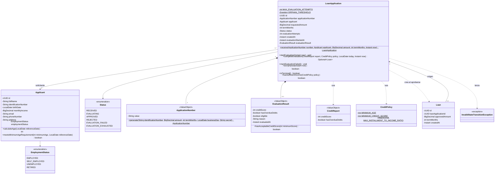
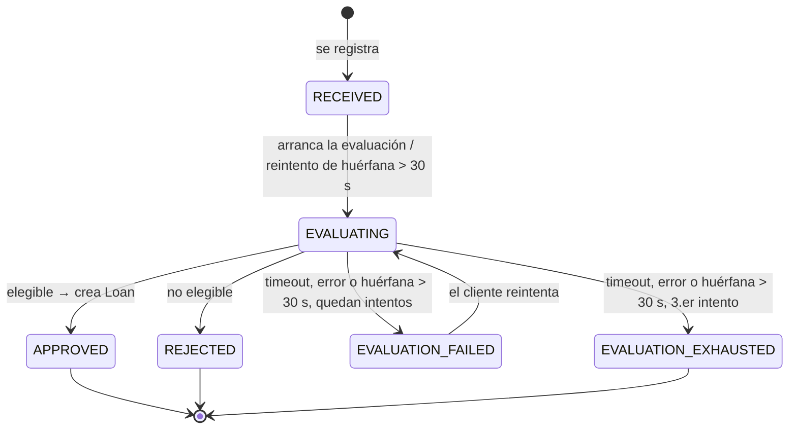
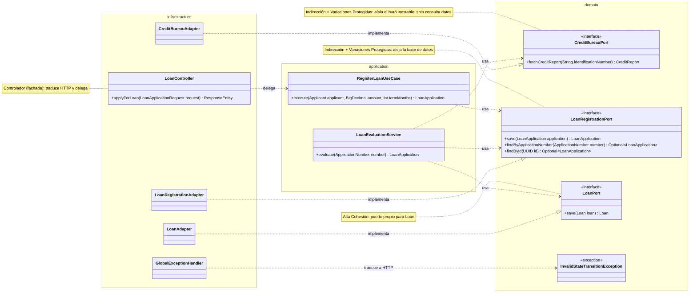

# Diagrama de clases — Sistema de solicitudes de préstamo

Dos vistas del mismo sistema:

- **A. Modelo de dominio** — entidades, value objects, enums y sus relaciones.
- **B. Capas y puertos** — cómo se conectan casos de uso, puertos y adaptadores (arquitectura hexagonal).

---

## A. Modelo de dominio

### Patrones aplicados en el modelo de dominio

| Clase | Patrón | Por qué |
|-------|--------|---------|
| `Applicant` | Experto en Información | Responde sobre su edad: tiene la fecha de nacimiento |
| `LoanApplication` | Experto en Información | Capacidad de pago y transiciones de estado: tiene monto, plazo, estado y contiene al solicitante |
| `LoanApplication` | Creador | Crea el `Loan` al aprobarse: tiene todos sus datos de inicialización |
| `EvaluationResult` | Experto en Información | Score aceptable: tiene el score informado por el buró |
| `EvaluationResult` | Alta Cohesión | Agrupa los datos de la evaluación; es `null` mientras no hay resultado |
| `Loan` | Bajo Acoplamiento | Llega al `Applicant` a través de su solicitud, sin referencia directa |
| `Status`, `EmploymentStatus` | — | Anidados en su entidad; en el diagrama se muestran aparte porque Mermaid no anida clases |

### Ciclo de vida de `LoanApplication`

---

## B. Capas y puertos

Todas las dependencias apuntan hacia `domain`; ninguna sale de él.

---

## Fuera de alcance

- Saldo, pagos y mora del préstamo (gestión de cartera).
- Monto aprobado distinto del pedido (contraoferta).
- Tasa de interés: la cuota se aproxima como `monto / plazo`.
- Historial de transiciones de estado.
